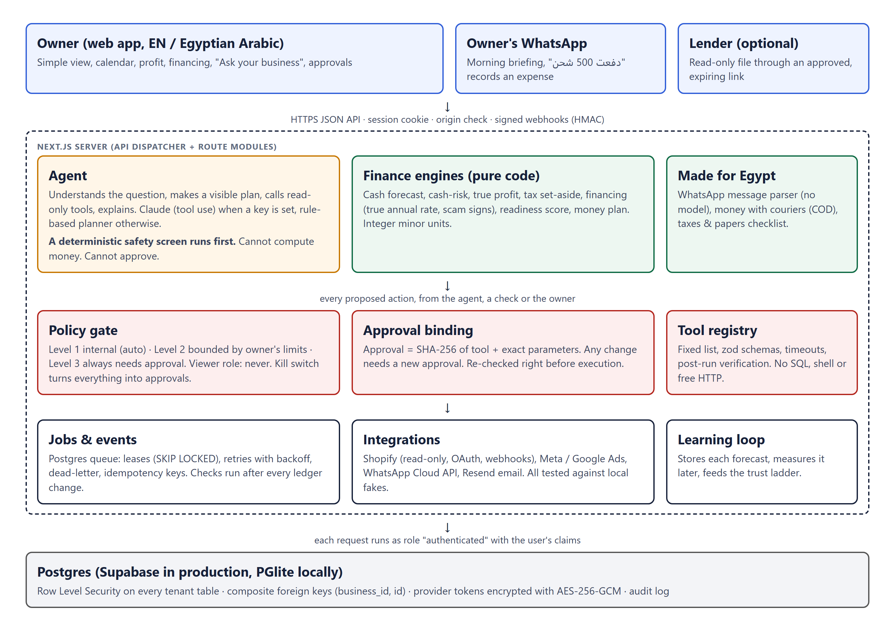

# Socio

Socio is a finance partner for small businesses, built for FinTechathon 2026 (Topic E, SME Finance Copilot).

Most of our users are shop owners and online sellers who have never had an accountant. Socio keeps track of their cash and
real profit, warns them before money runs short, compares loans by what they actually cost, and handles routine follow-ups.
Anything that spends money, changes a bill or shares data waits for the owner's approval. The app works in English and in
Egyptian Arabic.

Stack: Next.js 16 (App Router), TypeScript, Tailwind v4, Motion, Postgres (Supabase) with Row Level Security.

| | |
|---|---|
| Track | International AI Track, Topic E: SME Finance Copilot |
| Team | Socio: Mariam Islam, Omar Farha, Malak Elramy |
| Repository | https://github.com/mariamislamfe/socio |
| Live demo | Not deployed; run it locally in two commands (below) |

Docs in this repo:
- [docs/TECHNICAL.md](docs/TECHNICAL.md): architecture, algorithms, security design
- [docs/SECURITY_SELF_ASSESSMENT.md](docs/SECURITY_SELF_ASSESSMENT.md): permission levels and known risks
- [docs/evidence/](docs/evidence/): test logs and screenshots (the demo video is submitted separately)



Environment: Windows, macOS or Linux with Node.js 20 or newer. Nothing else is needed for local mode.

## Run it locally (no external services)

```bash
npm install
npm run dev          # starts an embedded Postgres (PGlite) on :54329 and Next.js on :3000
```

Open http://localhost:3000, register, and either start fresh or choose **Explore demo data** (a clearly labelled, separate
workspace with six months of activity, products and ~95 days of individual demo orders).

Local mode runs the same SQL migrations and the same `postgres` driver as production. Auth is a local stand-in for Supabase
Auth, and "forgot password" shows the reset link on screen because no email service exists.

## What the app does

New accounts open in a **simple view** made for beginners. The full view (switch in the menu) has everything below.

| Area | Where | Notes |
|---|---|---|
| Simple home | `/app` (simple view) | Cash now, safe to spend (with a "why this number?" breakdown), "I got money" / "I spent money", what is coming up, this month in plain words |
| Bills & fixed costs | `/app/fixed` | Three bands: salaries (one row per employee, a shared pay day, mark someone paid early, pay everyone), fixed costs that repeat, one-off bills and money owed to you |
| Business home | `/app` (full view) | Status, money available (cash only), next money event, the one thing to do next, attention items |
| Action Center | `/app/actions` | Recommendations, approvals, action history, email drafts, background jobs (retry), forecast vs reality, autonomy & kill switch |
| True profit | `/app/profit` | Revenue → cost of goods → gross → fees/shipping → ads → contribution → other costs → operating profit. Missing costs are shown as missing, never zero. Product economics from order lines |
| Money calendar | `/app/calendar` | Month grid of scheduled money with projected cash after each event; past items show what actually moved. Tap a day to add a payment or expected income on that date |
| Business-health checks | Action Center | Cash dip below the reserve, a product that loses money (break-even price), ad spend that does not pay for itself (marginal return vs break-even), money that belongs to the tax office (auto tax reserve) |
| Financing | `/app/financing` | How much is needed and by when; each offer's true annual rate, total cost, whether repayments create a new dip; scam warning signs; lender-ready file with fingerprint, shared only via an approved, expiring, revocable link (`/share/<token>`) |
| Money with couriers | `/app/cod` | Cash on delivery held by Bosta, Mylerz, J&T…: what each courier holds, late payouts flagged (oldest first), next payout; batches count in the forecast and calendar; "Received" records the money |
| Taxes & papers | `/app/tax` | No tax is estimated until the owner answers six questions about their papers. Then a 7-step checklist (commercial register, tax card, ETA portal, simplified regime under Law No. 6 of 2025, e-invoices, VAT, returns) that continues from where they stopped, in English and Egyptian Arabic |
| Ask your business | `/app/ask` | A deterministic safety screen runs first (money transfers, data requests, OTP/passwords, prompt injection, escalation, impersonation, out of scope) and answers without any tool or model. Then the agent: intent → visible plan → read-only tools → answer; actions only as policy-checked proposals. Claude tool use when configured, deterministic planner otherwise. Answers in Egyptian Arabic when the app is in Arabic or the question is written in Arabic |
| Trust ladder | Action Center → Autonomy & safety | Forecast accuracy and approval history; the co-pilot may *ask* for a bounded permission, only the owner can grant it |
| WhatsApp briefing | Settings → Notifications | Morning summary (Arabic or English) to the owner's own number after opt-in, via an approved template |
| Record by message | WhatsApp + Settings → Notifications | "دفعت 500 شحن" / "بعت ب 1200" become ledger entries in the right category with a confirmation; "الغي" undoes. Deterministic parser, owner's number only, signed webhook |
| Your money plan | `/app/plan` | What the owner can safely take this month (a share of real profit, never more than is free), what the business can still spend, and where every 100 of sales goes. Owner's pay reduces cash, not profit |
| Financing readiness | `/app/financing` | 0–100 score as a lender would see it (track record, profit, stability, data, collections, cushion, legal) with what to improve; warns when repayments exceed what the business earns |
| Media buyer | `/app/media-buyer` | Budget + country + dialect → affordability check, product that earns money, most a sale may cost, ad in the chosen dialect (owner edits = style examples), created on Meta paused (approval), started (second approval), followed up every 6 h: auto-pause losers, suggest scaling winners |
| Obligations, cash flow, budgets, goals, what-if, investments, company health, boardroom | `/app/*` | What-if also models supplier cost changes |
| Daily briefing | Home + scheduler | Built each morning (business time zone) from records |
| English ⇄ Egyptian Arabic | Top bar (مصري / English) | Whole interface in Egyptian Arabic, right-to-left; about 1,600 reviewed phrases plus patterns for sentences with numbers (`src/lib/i18n/eg*.ts`). Untranslated text stays English rather than being machine-guessed |

### The operating loop

1. **Observe** – ledger writes, Shopify webhooks and syncs emit durable `events`.
2. **Diagnose** – `src/lib/finance/cashrisk.ts` (pure): breach date, lowest balance, contributors, data quality; facts vs. plausible
   explanations vs. unknowns.
3. **Plan** – options are re-forecast deterministically (collect receivables, move a bill, trim ads, pause a recurring cost). An
   option is offered only if it raises the lowest balance or delays the first dip.
4. **Policy** – `src/lib/server/brain/policy.ts`: level 1 (internal: alert, task, email draft) runs automatically; level 2
   (payment reminder email) only within limits the owner set; level 3 (changing a bill's due date) always needs approval.
   Viewers can never trigger actions; a global pause turns everything into approvals.
5. **Execute** – `src/lib/server/brain/tools.ts` is the only way anything acts: a fixed registry with schemas, availability checks,
   timeouts and post-execution verification. Approvals are bound to a SHA-256 of the exact tool + parameters; any change needs a
   new approval. No tool runs SQL, shell commands or arbitrary HTTP.
6. **Learn** – each check stores a prediction (lowest balance by a date); once the date passes, it is measured against recorded
   cash and shown under "Forecast vs reality".

Jobs live in Postgres (`jobs`): leased with `FOR UPDATE SKIP LOCKED`, retried with exponential backoff, dead-lettered with a
notification, de-duplicated by idempotency key. On a long-running server an in-process worker (`src/instrumentation.ts`) runs
them; on serverless set `MARGIN_WORKER=off` and call `POST /api/cron/tick` with `Authorization: Bearer $CRON_SECRET` every 1–5 minutes.

## Use Supabase

1. Create a Supabase project.
2. Copy `.env.example` to `.env.local` and set:
   - `NEXT_PUBLIC_SUPABASE_URL`, `NEXT_PUBLIC_SUPABASE_ANON_KEY` (Project Settings → API)
   - `SUPABASE_DB_URL`: Connect → connection string, "Transaction pooler", with your DB password
   - `MARGIN_ENCRYPTION_KEY`: `node -e "console.log(require('crypto').randomBytes(32).toString('base64'))"`
   - `NEXT_PUBLIC_APP_URL`: your public https URL
3. Apply the schema: `npm run db:migrate` (applies everything in `supabase/migrations/` in order; safe to re-run).
4. Authentication → URL configuration: add `<APP_URL>/auth/callback` as a redirect URL.
5. `npm run build && npm start`.

Tenancy: every tenant table carries `business_id` with RLS built on `is_member` / `can_write` / `is_admin`. Each request runs
in a transaction that sets `request.jwt.claims` and `SET LOCAL ROLE authenticated`, so Postgres enforces isolation. Composite
foreign keys stop cross-tenant references. The service-role key is never used. Privileged work (webhooks, jobs) uses the owner
connection and always filters by `business_id`.

## Connect Shopify (real store)

Socio is a **standalone (non-embedded), read-only** app using the authorization-code grant with expiring offline tokens
(refreshed and rotated automatically).

1. **Deploy Socio on HTTPS first** (Shopify only delivers webhooks to public HTTPS) and set `NEXT_PUBLIC_APP_URL` to it.
2. In the [Dev Dashboard](https://dev.shopify.com) → **Apps → Create app**. Create a version with:
   - **App URL**: `<APP_URL>/api/integrations/shopify/install`
   - **Redirect URL**: `<APP_URL>/api/integrations/shopify/callback` (must match exactly)
   - **Scopes**: `read_orders,read_products,read_inventory` (add `read_all_orders` only if you need history older than 60 days;
     Shopify asks for a justification). Socio does not query customer fields.
   - **Webhooks API version**: `2026-07`
   - **Compliance webhooks** (`customers/data_request`, `customers/redact`, `shop/redact`): `<APP_URL>/api/webhooks/shopify`
   - Then **Release**.
3. App **Settings** → copy Client ID and Client secret into `SHOPIFY_CLIENT_ID` / `SHOPIFY_CLIENT_SECRET` on the server
   (never in frontend code or Git). Restart.
4. Install:
   - **A merchant's store**: Distribution → **Custom distribution** → enter the store domain → Generate link → send it to the
     owner. After installing, Shopify opens Socio; the owner signs in and confirms "Install with Shopify".
   - **A dev store in your own organization**: in Socio, Settings → Integrations, tick "Store is in the same Shopify organization"
     (client-credentials grant), or start from "Install with Shopify".
5. Socio verifies the store identity, registers its order/refund/product/inventory/uninstall webhooks, and runs the initial import
   as a job. **Run diagnostics** on the Shopify card checks token, identity, counts, pagination, persistence, idempotency, webhooks
   and recent deliveries. All of these checks are read-only.

Disconnect deletes Socio's webhooks at Shopify; "Uninstall from store" calls `appUninstall` and confirms the token stopped
working. Imported records stay until you choose "Remove imported data". `shop/redact` erases stored Shopify orders/payloads/tokens.

## Other integrations

| Provider | What you must provide |
|---|---|
| Meta Ads | `META_APP_ID`, `META_APP_SECRET`, `ads_read` approved; redirect `<APP_URL>/api/integrations/meta_ads/callback` |
| Google Ads | `GOOGLE_ADS_CLIENT_ID`, `GOOGLE_ADS_CLIENT_SECRET`, `GOOGLE_ADS_DEVELOPER_TOKEN`; redirect `<APP_URL>/api/integrations/google_ads/callback` |
| Email reminders | `RESEND_API_KEY` + `EMAIL_FROM` on a domain verified in Resend. Without them reminders become drafts |
| Claude | `ANTHROPIC_API_KEY` from console.anthropic.com (API usage is billed separately from Claude Pro/Max). Boardroom needs it; everything else works without |

Until credentials exist the UI says "Server setup required" and the connect button is disabled.

## Tests

Latest local results (logs in `docs/evidence/`): 243 unit tests, 164 API checks, 43 browser checks, a 56-check agent red-team,
26 checks for couriers and taxes, plus 98 checks in the Shopify, WhatsApp/agent, media-buyer and boardroom suites: 630 in total.
All passed.

```bash
npm run typecheck
npm run lint
npm test                 # vitest: engine, RLS/tenant isolation, jobs, policy, approvals, cash-risk, profit, Shopify pipeline
npm run build

# End-to-end against a running dev server:
npm run dev                                   # plain
npm run test:e2e                              # API checks (adapts to whether Shopify credentials are set)
npm run test:ui                               # real browser checks (npx playwright install chromium)

# With local fakes (no real Shopify / Claude is called):
SHOPIFY_CLIENT_ID=test_client SHOPIFY_CLIENT_SECRET=test_secret SHOPIFY_DEV_API_ORIGIN=http://127.0.0.1:4020 \
ANTHROPIC_API_KEY=test ANTHROPIC_BASE_URL=http://127.0.0.1:4010 CRON_SECRET=local-cron-test npm run dev
npx tsx scripts/shopify-e2e.mts               # OAuth, refresh/rotation, sync, webhooks, diagnostics, uninstall, compliance
npx tsx scripts/boardroom-e2e.mts             # streaming boardroom against a fake Anthropic API
npx tsx scripts/agent-e2e.mts                 # agent (tool use), WhatsApp briefing and record-by-message against local fakes
npx tsx scripts/mediabuyer-e2e.mts            # media buyer against a local fake Meta API (nothing real is created or spent)
npx tsx scripts/agent-redteam.mts             # attacks on the agent in English and Egyptian Arabic (no extra settings)
npx tsx scripts/egypt-e2e.mts                 # money with couriers and taxes & papers (no extra settings)
# for agent-e2e add: WHATSAPP_TOKEN=test WHATSAPP_PHONE_NUMBER_ID=123 WHATSAPP_API_BASE=http://127.0.0.1:4030 WHATSAPP_APP_SECRET=test_app_secret WHATSAPP_VERIFY_TOKEN=verify_me
# for mediabuyer-e2e add: META_APP_ID=test_meta META_APP_SECRET=test_meta_secret META_API_BASE=http://127.0.0.1:4040 META_SCOPES=ads_read,ads_management,pages_show_list,pages_manage_ads
```

## Layout

```
src/lib/finance/       pure engines (integer minor units): summaries, forecast, scenarios, cash-risk, profit, copilot
src/lib/server/        db, auth, tenancy, jobs, worker, routes, integrations
src/lib/server/brain/  policy, tool registry, actions (propose/approve/execute), workflows (cash risk, briefing, outcomes)
src/app/               landing, auth, onboarding, /app/* workspace, API dispatcher
src/components/        design system, charts, shell
supabase/migrations/   schema + RLS
scripts/               dev runner, migrations, e2e suites, local fakes (Shopify, Anthropic)
```

## Known limitations

- Supabase, Shopify, Meta, Google, WhatsApp and Claude were tested against local fakes and in-process Postgres, **not live accounts**.
- The cash forecast counts only 80% of typical sales on purpose. "Safe to spend" ignores income that has not arrived yet, so it
  can show 0 even when the business is healthy; the breakdown explains why.
- No currency conversion: non-base-currency records are flagged and excluded from totals.
- A few rarely used screens still show some English in Arabic mode.
- Notifications are in-app; email is used only for approved payment reminders.
- The in-process worker suits a persistent Node server; serverless needs the cron endpoint.
- Valuation multiples, readiness weights and the Egypt catalogue are guides to review, not authoritative rules.
- Local dev data lives in `~/.margin-dev` (outside the repo).
